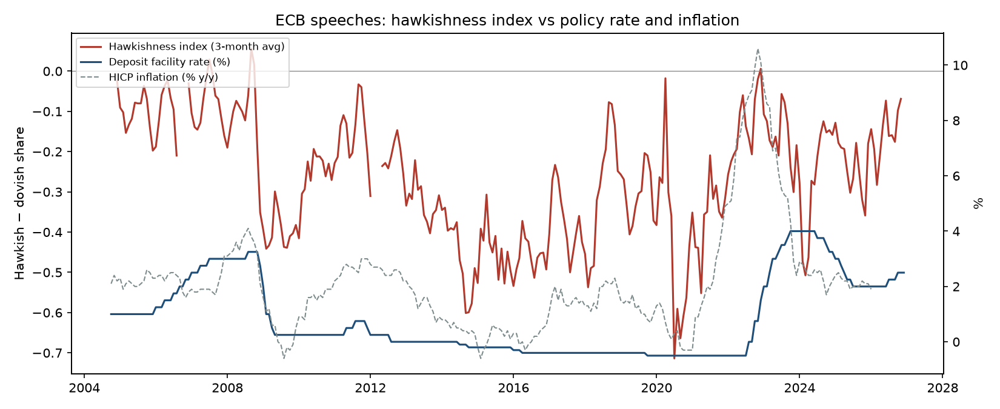

# ECB Hawkish–Dovish Monitor

Measuring the policy tone of **2,028 ECB Executive Board speeches (2004–2026)** with a transformer model fine-tuned on ECB communication, then testing whether that tone tracks inflation, anticipates rate changes, or moves euro yields.



## Key findings
1. **The index follows the policy cycle.** Tone collapses in late 2008, reaches its low in the COVID spring of 2020, and peaks with the late-2022 inflation spike.
2. **It tracks inflation:** correlation of the monthly index with euro-area HICP inflation = **0.43**.
3. **It does not anticipate rate moves.** After controlling for inflation and the past 3-month rate change, the index has no predictive power for the next 3-month change in the deposit facility rate (coef. −0.04, p = 0.68, n = 251 months). Past rate moves dominate (coef. 0.50, p < 0.001): ECB policy is persistent.
4. **Yields do not react to speeches.** On 1,475 speech days (excluding the week before rate changes), a 1-s.d. more hawkish speech moves the 2-year AAA euro yield by +0.08 bp (p = 0.42), and the 10-year by +0.09 bp (p = 0.37). This is consistent with markets taking policy signals from decision-day press conferences, not individual speeches.

These are honest negative results for points 3–4: no specification search was done after seeing them.

Full output: [`results/results.md`](results/results.md) · speech-level scores: [`results/speech_scores.csv`](results/speech_scores.csv)

## Method
| Step | Detail |
|---|---|
| Text | All ECB speeches CSV (ecb.europa.eu speeches dataset, updated 2026-11-01), 2004-09 onwards to match the yield data |
| Sentences | Split into sentences, footnote markers removed; kept 8–80-word sentences with monetary-policy vocabulary (51,372); random sample of up to 10 per speech, fixed seed (15,298) |
| Classifier | [`LorenzoAleCon29/roberta-base-dapt-ecb-hawkish-dovish`](https://huggingface.co/LorenzoAleCon29/roberta-base-dapt-ecb-hawkish-dovish): RoBERTa-base, domain-adapted on ECB text and fine-tuned on annotated ECB communication; reported test accuracy 65.0% (3 classes) |
| Score | Per speech: (hawkish − dovish) / classified sentences, in [−1, 1]; monthly average |
| Tests | OLS with Newey–West (HAC) standard errors: (1) next-3-month deposit-rate change on index, inflation and past rate change; (2) same-day change in 2y and 10y AAA euro yields (ECB yield curve) on standardised speech tone |

## Limitations
- **Classifier accuracy (65%)**: about 1 sentence in 3 is mislabelled. Averaging reduces random errors, not systematic ones.
- **Dovish skew**: the model labels 36.8% of sentences dovish vs 8.7% hawkish, so the index *level* is biased; its *changes* are what carry information.
- **Sampling**: up to 10 sentences per speech (the full set would take ~10 hours on a laptop CPU with the large model).
- **Daily data**: speeches and other news fall in the same day; intraday data would isolate the effect better.
- Model by an independent researcher with no licence stated: used for local inference only, not redistributed.

## Reproduce
```bash
python -m venv .venv && .venv/Scripts/pip install torch --index-url https://download.pytorch.org/whl/cpu && .venv/Scripts/pip install transformers pandas numpy scipy statsmodels matplotlib pytest
```
Put `all_ECB_speeches.csv` ([ECB speeches dataset](https://www.ecb.europa.eu/press/key/html/downloads.en.html)) and the ECB Data Portal series `yield_2y`, `yield_10y`, `dfr`, `hicp_yoy` (CSV) in `data/`, then:
```bash
.venv/Scripts/python -m pytest -q && .venv/Scripts/python hawkdove.py sentences && .venv/Scripts/python hawkdove.py classify && .venv/Scripts/python hawkdove.py analyze
```
